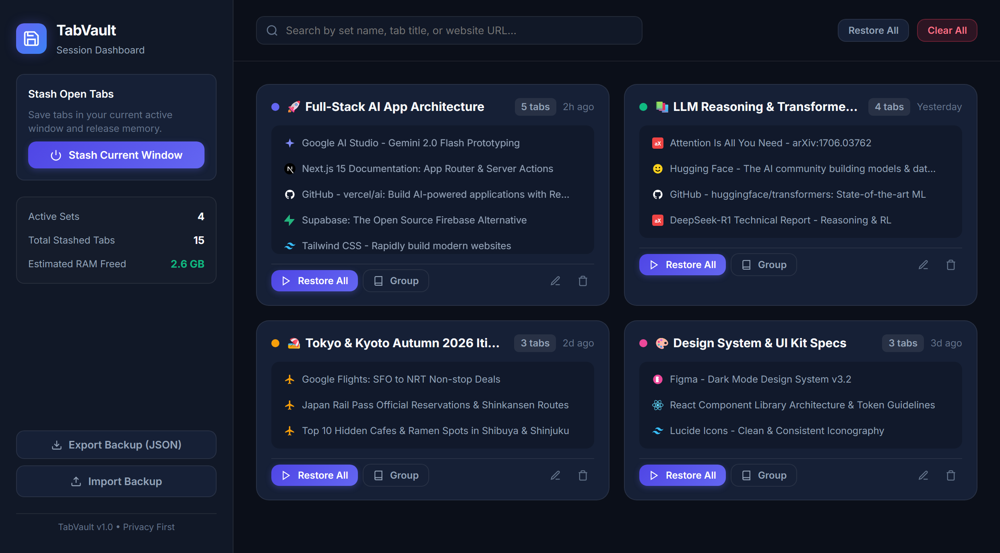
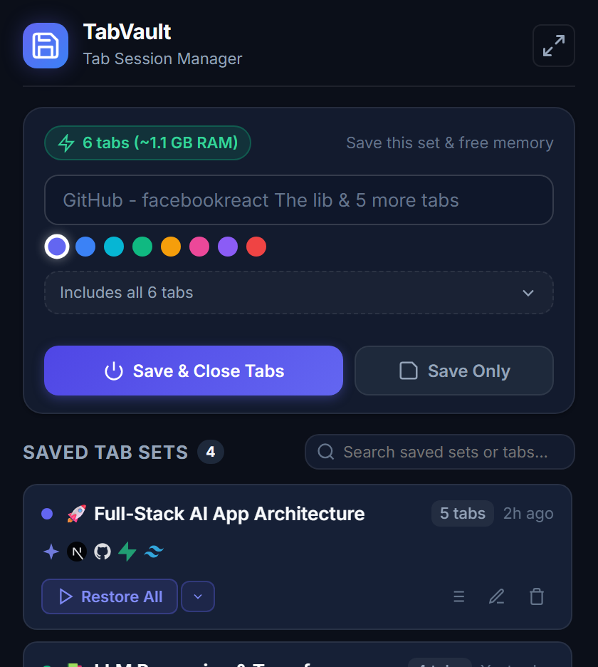
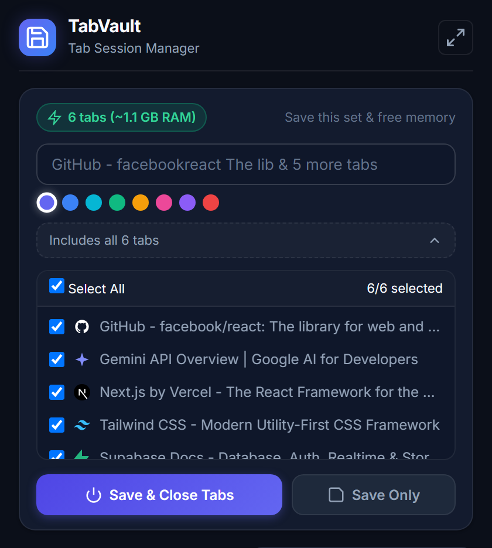
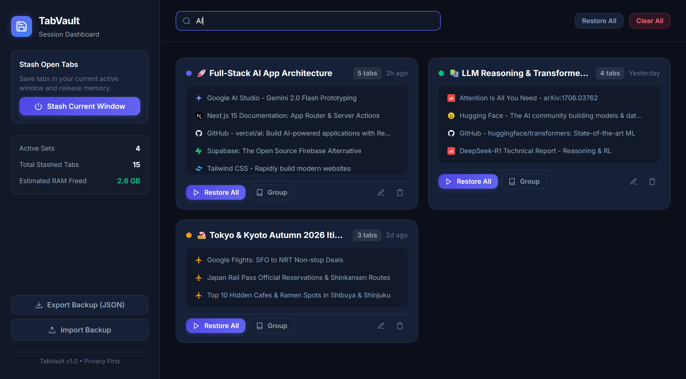

<div align="center">

  

  # TabVault 🗄️⚡
  ### The High-Performance Tab Session Manager for Google Chrome

  <p align="center">
    <strong>Save tab sets with custom names, reclaim gigabytes of RAM by closing them, and restore your exact workflow in one click anytime.</strong>
  </p>

  <p align="center">
    <a href="#-key-features"></a>
    <a href="#-privacy--permissions"></a>
    <a href="#-how-to-install"></a>
    <a href="LICENSE"></a>
  </p>

  <p align="center">
    <a href="#-the-problem">The Problem</a> •
    <a href="#-screenshots--ui-tour">Screenshots</a> •
    <a href="#-key-features">Key Features</a> •
    <a href="#-how-to-install">Installation</a> •
    <a href="#-usage-guide">Usage Guide</a> •
    <a href="#-shortcuts">Shortcuts</a> •
    <a href="#-architecture">Architecture</a>
  </p>

  ---

  

</div>

<br/>

## 💡 The Problem TabVault Solves

When multitasking, researching, or context-switching between projects, it's easy to accumulate **20, 40, or 60+ open tabs**. You cannot close them because you'll lose your train of thought, but keeping them open:

* 🚨 **Drains System RAM**: Each open Chrome tab consumes ~150–250 MB of memory. 30 tabs can easily devour 5 to 8 GB of RAM.
* 🔋 **Kills Battery Life**: Heavy background scripts drain laptop battery and trigger noisy fans.
* 🌪️ **Clutters Your Brain**: Tab titles shrink until they are illegible, turning your browser into a wall of indistinguishable favicons.

**TabVault provides the cleanest solution:**
1. **Name and tag** your current window's tabs into a labeled collection.
2. **Close them immediately** to free memory with the **Save & Close** button.
3. **Restore all tabs in one click** when you are ready to resume—either in a fresh window or grouped right into your active workspace as a **Chrome Tab Group**!

---

## 📸 Screenshots & UI Tour

### 1. Modern Popup Interface
Compact, dark-first popup UI featuring dynamic RAM consumption estimators, instant naming, vibrant color tags, and one-click stashing actions.

<div align="center">
  
</div>

<br/>

### 2. Selective Tab Stashing Drawer
Need to keep your background music or blank scratchpad open? Expand the tab drawer and deselect any tab before saving.

<div align="center">
  
</div>

<br/>

### 3. Full-Screen Session Dashboard & Search
A dedicated workspace (`dashboard.html`) showing aggregate metrics (active collections, total saved tabs, RAM reclaimed), backup utilities, and real-time deep search across session titles, page names, and URLs.

<div align="center">
  
</div>

<br/>

### 4. Real-Time Instant Filtering
Filter through dozens of saved tab sets effortlessly as you type.

<div align="center">
  
</div>

---

## ✨ Key Features

| Feature | Description |
| :--- | :--- |
| ⚡ **Save & Close (RAM Saver)** | Instantly stashes active tabs and closes them, reclaiming hundreds of megabytes or gigabytes of memory. |
| 💾 **Save Only Mode** | Creates a reliable restore point while keeping your current window and tabs untouched. |
| 🗂️ **Chrome Tab Groups** | Restore any collection directly as a named, color-coded native Chrome Tab Group inside your current window. |
| 🏷️ **Smart Naming & Color Tags** | Auto-generates sensible session names or accepts custom titles with 8 vibrant color categories. |
| 📋 **Selective Tab Stashing** | Collapsible tab list lets you review and uncheck specific tabs before saving. |
| 🔍 **Deep Instant Search** | Real-time filter across session titles, page titles, and destination URLs. |
| 📑 **Tab Inspection & Editing** | Expand any saved set to view, open individually, rename, or delete specific tabs. |
| 💻 **Full-Featured Dashboard** | Full-page management interface with memory freed counters and batch controls. |
| 📦 **JSON Backup & Import** | Complete portability—export your collections to JSON or restore them on any computer. |
| 🔒 **100% Private & Offline** | Zero telemetry, zero analytics, zero external API dependencies. All data stays inside your browser. |
| ⌨️ **Keyboard Shortcut** | Press `Alt + Shift + S` to stash your active window instantly without opening the popup. |

---

## 📥 How to Install

TabVault is built natively with **Chrome Extension Manifest V3** and runs directly in any Chromium-based browser (Google Chrome, Brave, Microsoft Edge, Arc, Opera, Vivaldi).

### Step-by-Step Instructions:

1. **Clone or Download** this repository:
   ```bash
   git clone https://github.com/your-username/tabvault.git
   ```
   *(Or download and extract the ZIP archive into a folder).*

2. Open Google Chrome and go to the Extensions page:
   ```text
   chrome://extensions/
   ```

3. Enable **"Developer mode"** via the toggle switch in the top-right corner.

4. Click the **"Load unpacked"** button in the top-left menu.

5. Select the folder containing `manifest.json`.

6. Click the puzzle icon in Chrome's top toolbar and **pin TabVault** for convenient one-click access!

---

## 🛠️ Usage Guide

### 1. Saving Tabs (Stashing)
1. Click the **TabVault** icon in your Chrome toolbar.
2. Check the real-time **RAM consumption badge** (e.g. `6 tabs (~1.1 GB RAM)`).
3. Enter a custom name (e.g., `ML Research Paper`, `Sprint Review 42`) or keep the auto-suggested title.
4. Select a color tag to visually distinguish the set.
5. *(Optional)* Click **"Includes all tabs"** to expand the list and uncheck any tabs you don't want to save.
6. Click **"Save & Close Tabs"** to close the tabs and reclaim memory, or **"Save Only"** to keep tabs active.

### 2. Restoring Tabs
TabVault offers flexible restoration modes:
* **Restore All (Default)**: Opens all tabs in a clean, isolated Chrome window.
* **Open as Tab Group**: Groups tabs directly into your active window under a colored Chrome Tab Group header.
* **Add to Current Window**: Appends tabs to your current window without grouping.
* **Open & Delete Set**: Single-use restore that opens the tabs and removes the session from storage.

### 3. Managing Sessions & Dashboard
* **Inline Rename**: Click directly on any session name to edit it in place.
* **Inspect Tabs**: Click the list icon (`≡`) on any card to view and manage individual tabs.
* **Full-Screen Dashboard**: Click the expand icon (`↗`) in the popup header to launch the full management console with backup/export controls.

---

## ⌨️ Shortcuts

| Shortcut | Action | Scope |
| :--- | :--- | :--- |
| `Alt + Shift + S` *(Mac: `Alt + Shift + S`)* | **Quick Stash Window** (Saves all tabs and frees RAM) | Global in Chrome |
| `Enter` | Save session from popup input | Popup |
| `Escape` | Close restore dropdown menus | Popup / Dashboard |

> **Tip:** You can customize this shortcut anytime by visiting `chrome://extensions/shortcuts` in Chrome.

---

## 🏛️ Architecture & Technologies

TabVault is engineered with zero runtime bloat, requiring no heavy frameworks, virtual DOM overhead, or build pipelines:

```text
┌────────────────────────────────────────────────────────┐
│                   Chrome Browser                       │
│  ┌───────────────────────┐  ┌───────────────────────┐  │
│  │   Popup UI            │  │  Full Dashboard       │  │
│  │   (popup.html / js)   │  │  (dashboard.html / js)│  │
│  └───────────┬───────────┘  └───────────┬───────────┘  │
│              │                          │              │
│              ▼                          ▼              │
│  ┌──────────────────────────────────────────────────┐  │
│  │             Shared Storage Utility               │  │
│  │                 (storage.js)                     │  │
│  └───────────────────────┬──────────────────────────┘  │
│                          │                             │
│                          ▼                             │
│  ┌──────────────────────────────────────────────────┐  │
│  │         chrome.storage.local (Offline)           │  │
│  └──────────────────────────────────────────────────┘  │
│                          ▲                             │
│                          │                             │
│  ┌───────────────────────┴──────────────────────────┐  │
│  │       Background Service Worker (MV3)            │  │
│  │               (background.js)                    │  │
│  │   • Keyboard command listener                    │  │
│  │   • Context menu integration                     │  │
│  │   • Extension badge counter                      │  │
│  └──────────────────────────────────────────────────┘  │
└────────────────────────────────────────────────────────┘
```

* **Chrome Extensions Manifest V3**: Built to the latest modern Chrome standards.
* **Vanilla JavaScript (ES2022)**: Lightning-fast execution, zero dependencies, instantaneous UI responsiveness.
* **Local Variable Fonts**: Bundles `Inter` variable font offline in `fonts/` for crisp, consistent typography across operating systems.
* **Modern CSS Design System**: CSS custom properties, grid and flexbox layouts, glassmorphism accents, and native dark mode styling.

---

## 📁 Directory Structure

```text
tabvault/
├── manifest.json              # Extension manifest (MV3, permissions, shortcuts)
├── background.js              # Service worker (shortcuts, badge updates, context menus)
├── storage.js                 # Shared persistence layer & session data models
├── popup.html                 # Extension toolbar popup layout
├── popup.css                  # Popup dark-first styling & animations
├── popup.js                   # Popup logic, tab query, and stash controller
├── dashboard.html             # Full-screen session management workspace
├── dashboard.css              # Dashboard layout, sidebar, & responsive card grid
├── dashboard.js               # Dashboard controller, search, backup/restore
├── generate_icons.py          # Icon generation utility using Pillow
├── capture_screenshots.py     # Automated Retina screenshot capture script
├── fonts/                     # Bundled offline typography
│   ├── inter.css
│   ├── inter-variable-latin.woff2
│   └── inter-variable-latin-ext.woff2
├── icons/                     # Extension branding icons
│   ├── icon16.png
│   ├── icon32.png
│   ├── icon48.png
│   └── icon128.png
├── screenshots/               # High-resolution documentation preview images
│   ├── dashboard-overview.png
│   ├── dashboard-search.png
│   ├── popup-interface.png
│   └── popup-expanded-tabs.png
└── README.md                  # Project documentation & guides
```

---

## 🛡️ Privacy & Permissions

TabVault is designed with a strict **Privacy-First** philosophy. We do not track you, we do not log your browsing habits, and we never transmit any data across the network.

### Required Permissions Explained:
* `tabs`: Required to read active URLs and titles to stash them and to restore tabs upon your command.
* `storage`: Required to store your saved tab sessions locally in `chrome.storage.local`.
* `tabGroups`: Required to group restored tabs into organized Chrome Tab Groups.
* `contextMenus`: Optional context menu shortcuts for quick stashing.

---

## 🤝 Contributing

Contributions, feature requests, and bug reports are welcome!
1. Fork the Project.
2. Create your Feature Branch (`git checkout -b feature/AmazingFeature`).
3. Commit your Changes (`git commit -m 'Add some AmazingFeature'`).
4. Push to the Branch (`git push origin feature/AmazingFeature`).
5. Open a Pull Request.

---

## 📄 License

Distributed under the **MIT License**. See `LICENSE` for more information.

<div align="center">
  <sub>Built with care for tab hoarders and power users everywhere. ⚡</sub>
</div>
